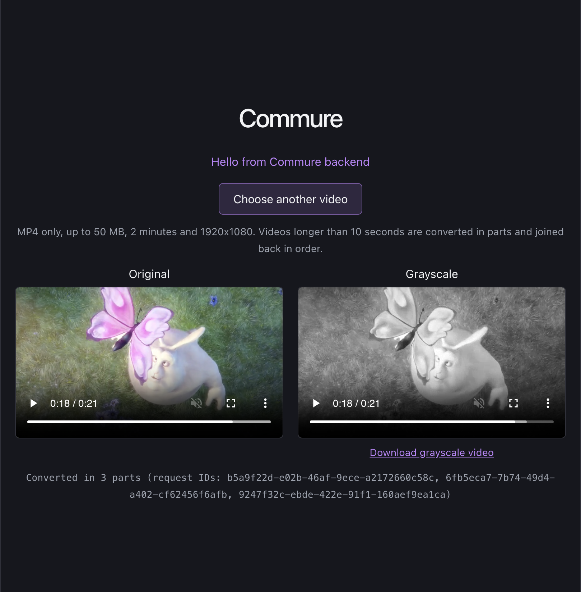
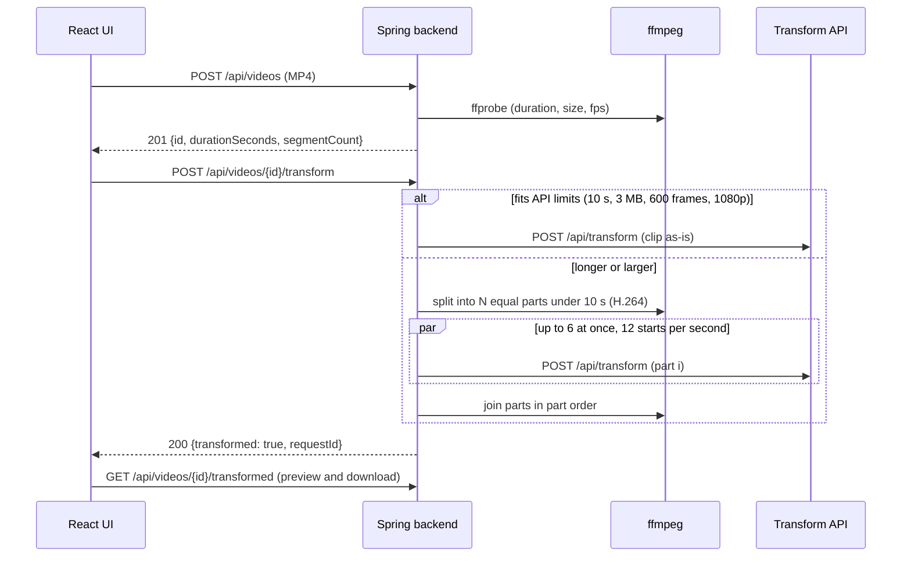

# Grayscale video transform: team guide

Upload an MP4, preview it, and convert it to grayscale through the third-party transform API. Videos up to 2 minutes and 50 MB are supported. The API itself only accepts clips of 10 s and 3 MB, so longer videos are split into parts, converted in parallel, and joined back in order.



## 1. What you need

| Tool | Version | Why | Check |
|------|---------|-----|-------|
| Java (JDK) | 27 | Spring Boot 4.1.2 backend | `java -version` |
| Node.js | 22 or newer (tested on 26) | Vite 8 frontend | `node -v` |
| ffmpeg + ffprobe | any recent (tested on 9.0) | Splitting and joining videos longer than 10 s | `ffmpeg -version` |
| curl | any | Simulation script | `curl --version` |

Maven is not needed; the repo ships `./mvnw`. Docker is not needed for this feature.

Install ffmpeg on macOS with `brew install ffmpeg` (Linux: `apt install ffmpeg`). Without ffmpeg the app still works for clips that already fit the API limits (10 s, 3 MB), and rejects anything larger with a friendly message. The ffmpeg-based tests are skipped.

## 2. One-time setup

```bash
git clone <repo-url> && cd Commure

# Credentials for the third-party API (ask the project owner for the values)
cp .env.example .env
# then edit .env:
#   BASE_URL=https://...
#   TRANSFORM_SERVICE_TOKEN=...

cd frontend && npm install && cd ..
```

`.env` is gitignored and is read only by the backend; the token is never sent to the browser. **Never commit `.env` or paste the token into chat or tickets.** Real environment variables override `.env`.

The first backend run downloads Maven dependencies, so it needs network access and takes a minute or two.

## 3. Run the app

Two terminals from the repo root:

```bash
# Terminal 1: backend on http://localhost:8080
cd backend && ./mvnw spring-boot:run

# Terminal 2: frontend on http://localhost:5173 (proxies /api to :8080)
cd frontend && npm run dev
```

Open http://localhost:5173, then:

1. Click **Upload video** and pick an MP4. The original preview appears.
2. Click **Convert to grayscale**. A spinner shows "Converting to grayscale..." for short clips, or "Converting N parts to grayscale..." for longer videos.
3. The grayscale preview appears next to the original, with a **Download grayscale video** link and the API request IDs.

If ffmpeg is not on the `PATH`, point the backend at it: `FFMPEG_PATH=/path/to/ffmpeg FFPROBE_PATH=/path/to/ffprobe ./mvnw spring-boot:run`.

## 4. Run the tests

```bash
# Everything quick: video backend tests, frontend tests, lint and build
./scripts/verify-quick.sh

# Backend only
cd backend && ./mvnw test                                                      # full suite
cd backend && ./mvnw test -Dtest='Video*Test,Transform*Test,LongVideo*Test'    # video feature only

# Frontend only
cd frontend && npm test && npm run lint && npm run build
```

The backend tests never call the real API. They use a mock server, plus a fake API on a real socket that can answer out of order, return any error code, and measure how many requests are in flight.

## 5. Simulate against the real API

With the backend running (step 3, terminal 1) and valid credentials in `.env`:

```bash
./scripts/simulate-video.sh all                    # all steps below
./scripts/simulate-video.sh upload                 # validation only; no API calls
./scripts/simulate-video.sh transform              # one short clip through the real API -> transformed.mp4
./scripts/simulate-video.sh long                   # clip looped to 24 s, 3 parts -> transformed-long.mp4
./scripts/simulate-video.sh all path/to/clip.mp4   # use your own clip
```

The script defaults to `short.mp4` in the repo root. Sample videos are not committed, so pass your own short H.264 MP4 (up to 10 s) if you don't have it. The script prints `[PASS]`/`[FAIL]` per check and exits non-zero on any failure.

To run your own long video by hand:

```bash
ID=$(curl -s -F "file=@my-video.mp4;type=video/mp4" localhost:8080/api/videos | sed -E 's/.*"id":"([^"]+)".*/\1/')
curl -s -X POST localhost:8080/api/videos/$ID/transform
curl -s -o grayscale.mp4 localhost:8080/api/videos/$ID/transformed
```

## 6. Key results

All numbers below come from actual runs on Oct 27, 2026.

**Automated tests**

| Suite | Result |
|-------|--------|
| Backend (`./mvnw test`, whole project) | 122 passed, 0 failed |
| Frontend (`npm test`) | 51 passed; lint and build clean |
| `./scripts/verify-quick.sh` | 6 passed, 0 failed |
| Concurrency and long-video integration tests | Passed 3 runs in a row |

**Real API simulation:** `./scripts/simulate-video.sh all` passed 25 of 25 checks, covering upload validation, a single clip, and a 24 s video split into 3 parts.

**Sample videos through the real API**

| Video | Length | Parts | Conversion time | Frames in = out |
|-------|--------|-------|-----------------|-----------------|
| `short.mp4` | 8 s | 1 (sent as-is) | not timed separately | 192 = 192 |
| `boundary.mp4` | 20 s (exact multiple of 10) | 3 | 2 s | 480 = 480 |
| `partial.mp4` | 21 s (short tail) | 3 | 2 s | 504 = 504 |
| `long.mp4` | 30 s | 4 | 3 s | 720 = 720 |
| `extended.mp4` | 65 s | 7 | 5 s | 1560 = 1560 |

For every video:

- **Grayscale:** the output's colour saturation was 0 on every frame.
- **Order:** output frames matched the original frame by frame at the same timestamps (about 34 to 37 dB PSNR on brightness). Shifting the comparison by 10 s dropped the match to about 12 dB, so the parts are in the correct order.

**Limits held under test**

- At most 6 API requests in flight at once. A 2-minute video (13 parts) peaked at exactly 6.
- At most 12 requests started per second.
- Every part sent to the API was 3 MB or less, 10 s or less, 600 frames or fewer, and H.264.
- Out-of-order API responses still produce the correct timeline.

## 7. How it works



| Endpoint | Purpose |
|----------|---------|
| `POST /api/videos` (multipart field `file`) | Validate and store the original; returns `201` with `id` and `segmentCount` |
| `POST /api/videos/{id}/transform` | Convert to grayscale (in parts if needed) and store the result |
| `GET /api/videos/{id}/transformed` | Stream the grayscale MP4 (supports Range, needed by Safari) |

Code lives in `backend/src/main/java/com/commure/backend/video/` and `frontend/src/video/`. `VideoService` holds the business logic, `VideoProcessor` wraps ffmpeg, and `TransformClient` calls the API with the concurrency cap, pacing and retries.

## 8. Errors users can see

Every error is JSON `{code, message, requestId, retryAfterSeconds}`, and the UI shows the message as-is. For split videos, a failed part is named, e.g. "Part 2 of 3: This video is not supported...".

| Code | HTTP | When |
|------|------|------|
| `UNSUPPORTED_TYPE` | 415 | Not an MP4 |
| `FILE_TOO_LARGE` | 413 | Over 50 MB |
| `VIDEO_TOO_LONG` | 422 | Over 2 minutes |
| `UNREADABLE_VIDEO` | 422 | ffmpeg can't read the file |
| `PROCESSING_FAILED` | 500 | Splitting or joining failed |
| `PROCESSOR_UNAVAILABLE` | 503 | Video needs splitting but ffmpeg isn't installed |
| `INVALID_REQUEST` | 400 | API returned 400 |
| `SERVICE_AUTH_FAILED` | 502 | API returned 401 (bad or expired token) |
| `SESSION_NOT_LIVE` | 503 | API returned 403 |
| `LIMIT_EXCEEDED` | 413 | API returned 413 |
| `UNSUPPORTED_VIDEO` | 422 | API returned 422 |
| `RATE_LIMITED` / `SERVICE_UNAVAILABLE` | 429 / 503 | API busy; the UI counts down `Retry-After` before allowing a retry |
| `OUTPUT_TOO_LARGE` | 502 | API output over 4 MB |
| `TIMEOUT` | 504 | API unreachable or too slow |
| `NOT_CONFIGURED` | 503 | `BASE_URL` or `TRANSFORM_SERVICE_TOKEN` missing |

## 9. Troubleshooting

| Symptom | Fix |
|---------|-----|
| "The transformation service rejected our credentials" (`SERVICE_AUTH_FAILED`) | The token expired or is wrong. Update `.env` and **restart the backend**, because `.env` is read only at startup. |
| "Video transformation is not configured on the server" | `.env` is missing or empty in the repo root, or the backend was started before you created it. |
| "Long videos can't be processed on this server right now" | ffmpeg isn't on the backend's `PATH`. Install it, or set `FFMPEG_PATH`/`FFPROBE_PATH`. |
| UI says "can't reach the server" | The backend isn't running on port 8080. |
| `Port 8080 was already in use` | Stop the other process: `lsof -ti :8080 \| xargs kill`. |
| Simulation says `Clip not found` | Pass a clip path: `./scripts/simulate-video.sh all my-clip.mp4`. |

## 10. Known limitations

- Videos and results are kept in backend memory only (latest 20 uploads or 500 MB) and are lost on restart. Each backend instance has its own store.
- Conversion is a single request that waits for the whole video. A 2-minute video takes several seconds, with a spinner and no progress bar.
- Simultaneous ffmpeg jobs aren't capped, so many concurrent long uploads are CPU-bound.
- The output has no audio, because the transform API returns video only.
- The UI enforces 1920x1080 at most; the backend would downscale larger input, but the UI keeps the original rule.
